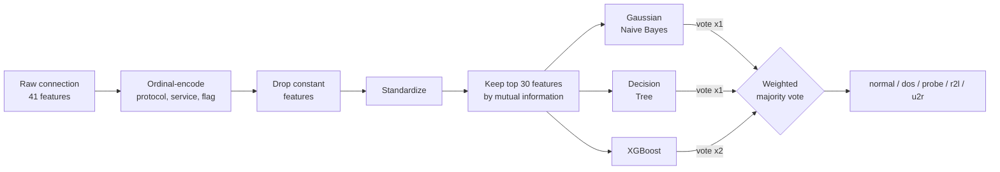
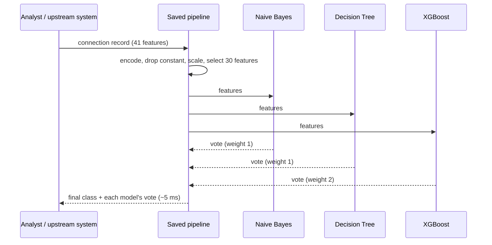
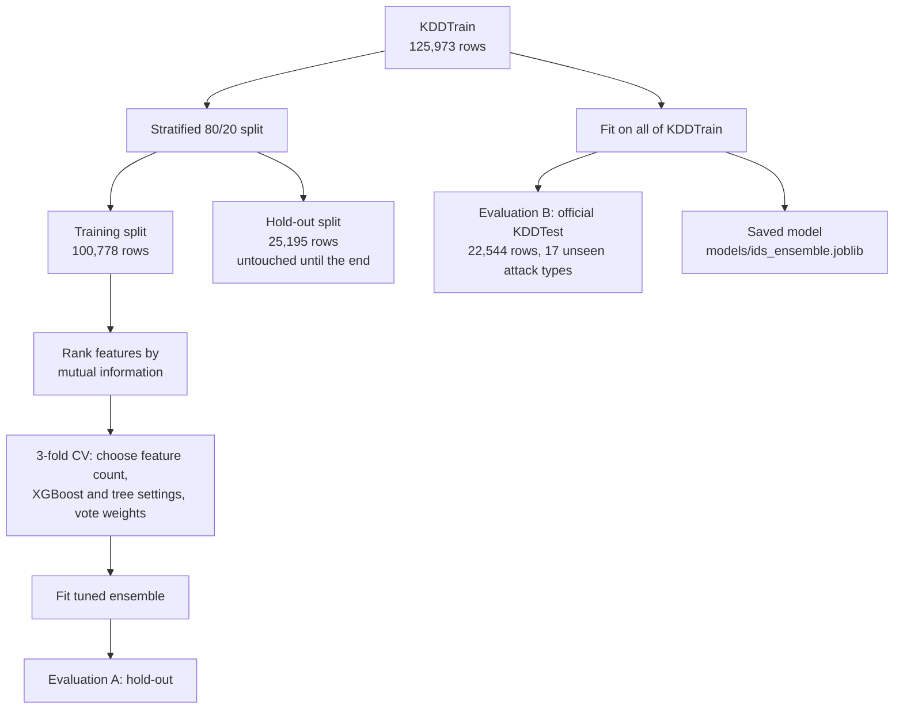
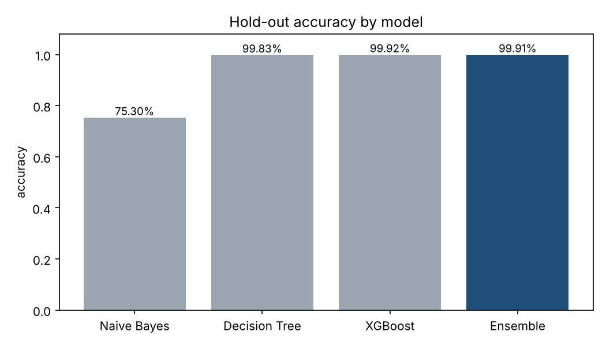
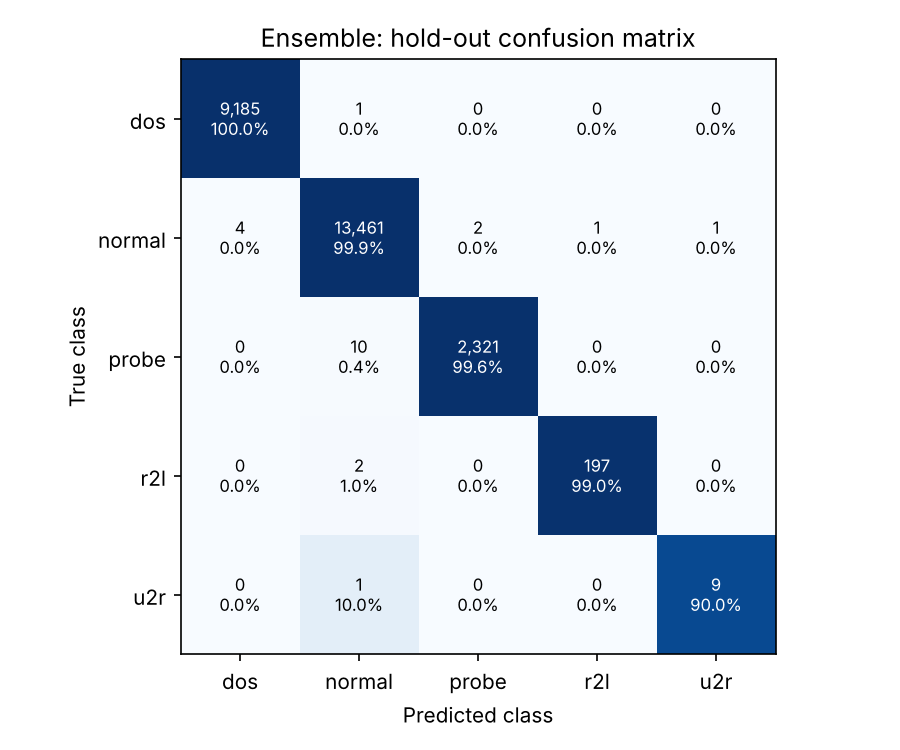
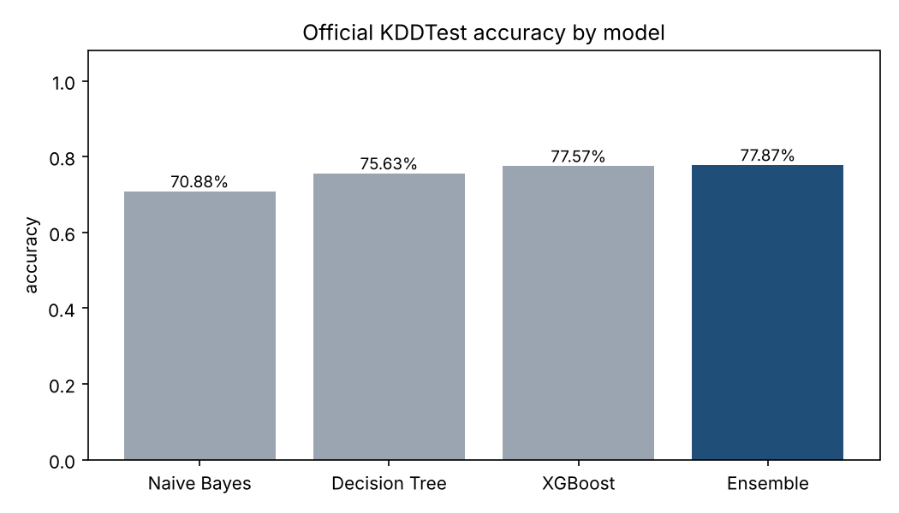
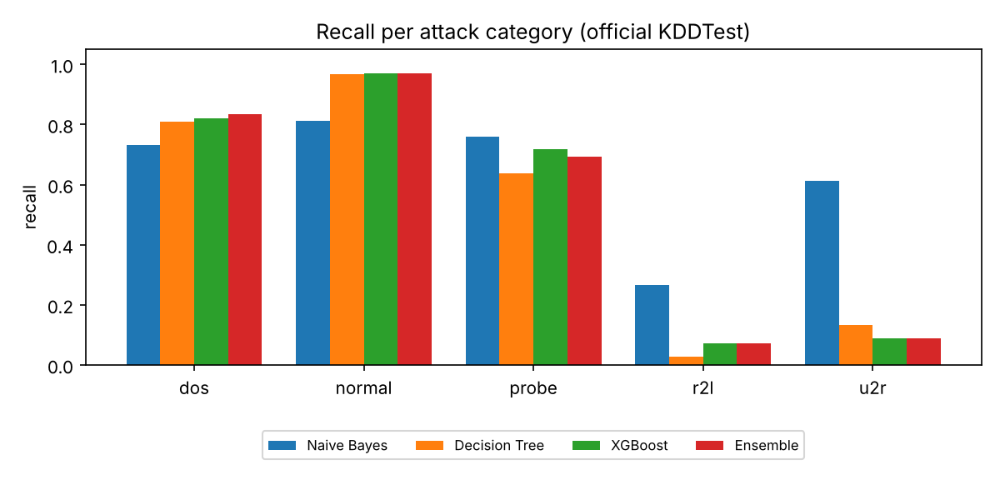
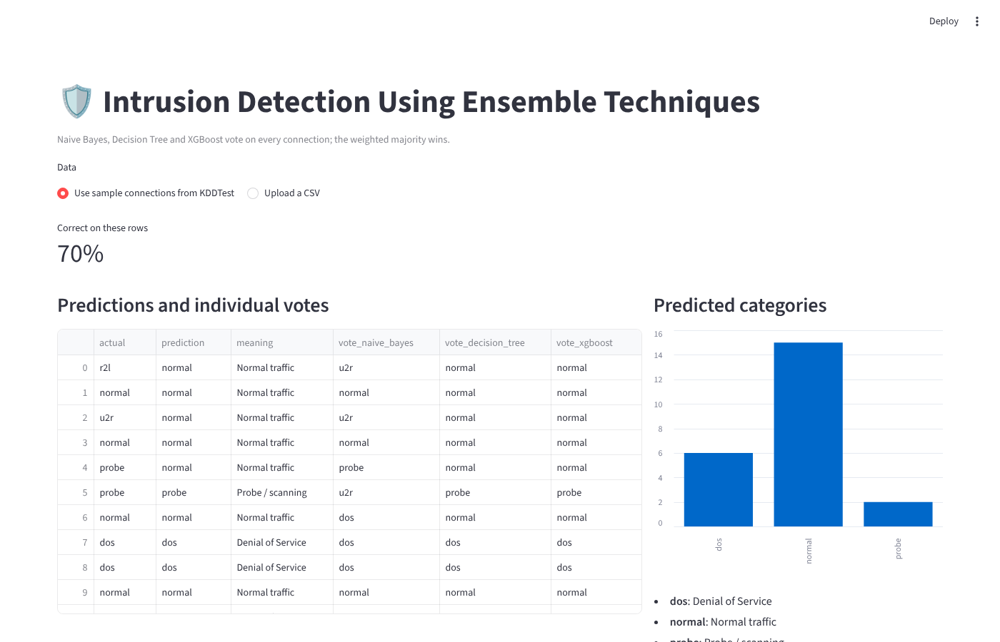

# 🛡️ Intrusion Detection Using Ensemble Techniques

**A security analytics system that inspects every network connection and decides, in about 5 milliseconds, whether it is normal traffic or one of four attack families, using a Maximum Voting Ensemble of Gaussian Naive Bayes, a Decision Tree, and XGBoost.**


[](https://colab.research.google.com/github/aish-19shanbhag/intrusion-detection-ensemble/blob/main/notebooks/intrusion_detection_walkthrough.ipynb)

| | |
|---|---|
| **Problem** | Detect malicious network connections among normal traffic and say which kind of attack each one is |
| **Data** | NSL-KDD: 148,517 labelled connections, 41 features, 5 classes |
| **Approach** | Feature selection by mutual information, three diverse classifiers, weighted hard voting, cross-validated tuning |
| **Result** | **99.91% accuracy** and a **0.06% false positive rate** on a held-out 20% test set |
| **Role** | Team Lead. Built Aug 2021 to Jan 2022; refactored into a reproducible, tested pipeline in 2026 |

---

## Highlights

- **99.91% accuracy, 0.06% false positive rate** (normal traffic wrongly flagged) on 25,195 held-out connections; **99.87% ± 0.03%** in 5-fold cross-validation.
- **Benchmarked against every base classifier**, on the hold-out set and on the harder official NSL-KDD test set, where the ensemble scores highest (77.87% against 77.57%, 75.63% and 70.88%).
- **Feature selection** cut the inputs from 41 to 30 with no meaningful loss in accuracy.
- **Fast enough for real-time use:** about 5 ms to score one connection, about 60,000 connections per second in batches.
- **One end-to-end pipeline:** preprocessing, selection and the ensemble are a single object, so training and live scoring run identical steps.

## ✨ Key features

| | Feature | What it does |
|---|---|---|
| 🗳️ | **Maximum Voting Ensemble** | Three very different learners vote on every connection; weighted majority voting gives the final class |
| 🎯 | **Five-way attack classification** | Separates normal traffic from DoS, Probe, R2L and U2R attacks, not just "attack or not" |
| 🔍 | **Feature selection** | Mutual-information ranking keeps the 30 most informative of 41 features |
| ⚙️ | **Cross-validated tuning** | Staged grid search over feature count, model settings and vote weights, without touching the test set |
| 📊 | **Benchmarking** | Every result is compared against each base classifier, on two different test sets |
| ⚡ | **Real-time scoring** | About 5 ms per connection; about 60,000 connections per second in batches |
| 🧩 | **Single end-to-end pipeline** | Preprocessing, selection and the ensemble ship as one saved object, so training and scoring can never drift apart |
| 🖥️ | **Interactive demo** | A Streamlit app shows each prediction and how every model voted |
| ✅ | **Reproducible and tested** | Fixed seeds, saved metrics, automated tests, and a one-click Colab notebook |

## Why it matters

Intrusion detection is a rare-event problem with uneven costs. A missed attack can mean a breach, but a system that raises too many false alarms gets ignored by the analysts who must review them. That's why this project reports the **false positive rate and per-class recall**, not only accuracy.

---

## Architecture



## How one connection is scored



## Training and evaluation workflow



---

## Dataset

[NSL-KDD](https://www.unb.ca/cic/datasets/nsl.html) (Canadian Institute for Cybersecurity) is a refined version of KDD Cup 99 with redundant records removed. Each row is one network connection with 41 features: basic properties (duration, protocol, bytes sent), content features (failed logins, root access), and traffic statistics over the last two seconds and the last 100 connections.

| Class | Meaning | KDDTrain | KDDTest |
|---|---|---|---|
| normal | Legitimate traffic | 67,343 (53.5%) | 9,711 (43.1%) |
| dos | Denial of Service: flood a host so it cannot serve users | 45,927 (36.5%) | 7,460 (33.1%) |
| probe | Scanning to find targets and weaknesses | 11,656 (9.3%) | 2,421 (10.7%) |
| r2l | Remote to Local: gain access from a remote machine | 995 (0.8%) | 2,885 (12.8%) |
| u2r | User to Root: escalate a normal account to root | 52 (0.04%) | 67 (0.3%) |

The 23 specific attack labels in training (38 in test) are mapped to these five families in `src/config.py`. **KDDTest contains 17 attack types that never appear in KDDTrain** (3,750 rows), which is why it's used as the harder second benchmark.

---

## Methodology

**1. Preprocessing** (`src/preprocessing.py`)
- `protocol_type`, `service` and `flag` are ordinal-encoded. Unseen categories map to -1 instead of crashing at prediction time.
- `num_outbound_cmds` is constant and is dropped automatically.
- All features are standardized. Every step is fitted on training data only.

**2. Feature selection** (`src/tune.py`)
- All 41 features are ranked by mutual information with the attack category ([chart](reports/figures/feature_ranking.png)).
- Feature sets of 10, 20, 30 and 41 are compared with 3-fold cross-validation. The smallest set within 0.02 points of the best accuracy is kept: **30 features**.
- The strongest signals are `src_bytes`, `service`, `diff_srv_rate`, `flag` and `same_srv_rate`.

**3. Models** (`src/models.py`)

| Model | Why it's in the ensemble |
|---|---|
| Gaussian Naive Bayes | Fast probabilistic model that makes very different errors from tree models |
| Decision Tree | Captures sharp, rule-like thresholds typical of attack traffic |
| XGBoost | Gradient-boosted trees; the strongest single model |
| **Maximum Voting Ensemble** | Hard voting with weights 1 : 1 : 2, so XGBoost breaks ties and the other two can outvote it when they agree |

**4. Hyperparameter tuning:** a staged grid search with 3-fold stratified cross-validation on the training split only. All results are in [`reports/metrics/tuning_results.csv`](reports/metrics/tuning_results.csv).

| Component | Searched | Chosen |
|---|---|---|
| Features kept | 10, 20, 30, 41 | 30 |
| XGBoost | trees 100/300, depth 6/10, learning rate 0.1/0.3 | 300 trees, depth 10, learning rate 0.1 |
| Decision Tree | max depth None/30, min samples per leaf 1/2 | default (unlimited depth, 1) |
| Vote weights (NB, DT, XGB) | 1:1:1, 1:1:2, 1:2:2, 1:2:3 | 1:1:2 |

**5. Evaluation**
- **A. Hold-out:** a stratified 80/20 split of KDDTrain. The 20% is never used for selection or tuning.
- **Cross-validation:** 5 folds on the training split, to check stability.
- **B. Official benchmark:** train on all of KDDTrain, test on KDDTest.

---

## Results

### A. Hold-out test set (25,195 connections)

| Model | Accuracy | Macro F1 | False positive rate | Attack detection rate |
|---|---|---|---|---|
| Gaussian Naive Bayes | 75.30% | 0.523 | 39.82% | 97.56% |
| Decision Tree | 99.83% | 0.945 | 0.15% | 99.80% |
| XGBoost | 99.92% | 0.978 | 0.05% | 99.88% |
| **Ensemble** | **99.91%** | **0.978** | **0.06%** | **99.88%** |

5-fold cross-validation of the full pipeline: **99.87% ± 0.03%**.

| Recall per class | dos | normal | probe | r2l | u2r |
|---|---|---|---|---|---|
| Ensemble | 99.99% | 99.94% | 99.57% | 98.99% | 90.0% (9 of 10) |

<p align="center">
  
  
</p>

### B. Official NSL-KDD test set (22,544 connections, includes unseen attack types)

| Model | Accuracy | Macro F1 | False positive rate | Attack detection rate |
|---|---|---|---|---|
| Gaussian Naive Bayes | 70.88% | 0.550 | 18.81% | 82.07% |
| Decision Tree | 75.63% | 0.484 | 3.38% | 69.34% |
| XGBoost | 77.57% | 0.546 | 2.96% | 66.19% |
| **Ensemble** | **77.87%** | **0.547** | **2.96%** | **66.27%** |

<p align="center">
  
  
</p>

### Interactive demo

<p align="center"></p>

The demo scores 23 labelled connections from the official test set (including attack types never seen in training) and shows each model's vote. You can also upload your own CSV.

### Speed (ensemble, including preprocessing)

| Measure | Result |
|---|---|
| One connection | 4.8 ms (median of 200) |
| Batch of 10,000 | 0.17 s, about 60,000 connections per second |

---

## Key findings

1. **On data like its training data, the ensemble is near-perfect:** 99.91% accuracy with only 6 in 10,000 normal connections falsely flagged.
2. **The ensemble's value shows on the harder test.** On the hold-out set, XGBoost alone and the ensemble are within 0.04 points of each other. On the official test set, with new attack types, the ensemble is the most accurate model: combining diverse learners helps most when the data shifts.
3. **Accuracy drops from 99.9% to 77.9% on the official test set.** Most of the gap comes from R2L attacks: rare in training (0.8%), common in testing (12.8%), and partly of types never seen before. This is the classic limitation of supervised intrusion detection, and it's why real systems pair classifiers with anomaly detection.
4. **Naive Bayes alone is a poor detector** (40% false positive rate on the hold-out set), but as one voter among three it adds diversity without dominating, because the weights let the tree models overrule it.

> **Note on the original result:** the 2021 version of this project reported **99.93% accuracy and a 0.07% false positive rate**. This refactored pipeline fits encoders on training data only, selects features and tunes by cross-validation, and fixes every random seed. It reproduces **99.91% and 0.06%**.

---

## 🧰 Tech stack

| Layer | Tools |
|---|---|
| Language | Python 3.10+ |
| Data | pandas, NumPy |
| Machine learning | scikit-learn (Gaussian Naive Bayes, Decision Tree, VotingClassifier, Pipeline, ColumnTransformer, mutual information), XGBoost |
| Evaluation and charts | scikit-learn metrics, Matplotlib |
| Model persistence | joblib |
| Demo | Streamlit |
| Testing | pytest |
| Notebook | Jupyter / Google Colab |

## 🧠 Concepts demonstrated

- Ensemble learning: hard majority voting, vote weighting, and model diversity
- Multi-class classification on a severely imbalanced dataset (U2R is 0.04% of training data)
- Feature selection with mutual information
- Hyperparameter tuning with stratified k-fold cross-validation
- Leakage-free preprocessing: every transformation fitted on training data only
- Evaluation beyond accuracy: false positive rate, detection rate, per-class recall, macro F1, confusion matrices
- Generalization testing on a benchmark with unseen attack types
- Latency and throughput measurement for real-time use

## Repository structure

```
intrusion-detection-ensemble/
├── app/
│   └── streamlit_app.py        # interactive demo: predictions and each model's vote
├── data/
│   ├── KDDTrain.txt            # NSL-KDD training set (125,973 rows)
│   ├── KDDTest.txt             # NSL-KDD official test set (22,544 rows)
│   └── sample_connections.csv  # 23 labelled test rows for the demo
├── models/
│   └── ids_ensemble.joblib
├── notebooks/
│   └── intrusion_detection_walkthrough.ipynb   # run everything in Colab
├── reports/
│   ├── figures/                # charts used in this README
│   ├── screenshots/            # demo screenshot
│   └── metrics/                # metrics.json, tuning_results.csv, best_params.json, feature_ranking.csv
├── src/
│   ├── config.py               # paths, schema, attack taxonomy
│   ├── data_loader.py          # load NSL-KDD, map labels to 5 classes
│   ├── preprocessing.py        # encoding, scaling, mutual-information ranking
│   ├── models.py               # base models, voting ensemble, pipeline
│   ├── tune.py                 # feature selection and hyperparameter tuning
│   ├── train.py                # training, benchmarking, evaluation, saving
│   ├── evaluate.py             # metrics and charts
│   └── predict.py              # score new connections
├── tests/
│   └── test_pipeline.py
└── requirements.txt
```

## Getting started

**In the browser, no installation:** click **Open in Colab** at the top, then **Runtime > Run all**.

**Locally:**

```bash
git clone https://github.com/aish-19shanbhag/intrusion-detection-ensemble.git
cd intrusion-detection-ensemble
pip install -r requirements.txt

python -m src.tune                                 # optional: feature selection and tuning (~5 min)
python -m src.train                                # train, benchmark, write reports/
python -m src.predict data/sample_connections.csv  # score new connections
streamlit run app/streamlit_app.py                 # interactive demo
pytest -q                                          # tests
```

## Limitations and next steps

- NSL-KDD is a benchmark dataset from simulated traffic; modern traffic (for example CIC-IDS2017 or UNSW-NB15) would test generalization further.
- Add an unsupervised anomaly detector (Isolation Forest or an autoencoder) alongside the ensemble to catch attack types that never appear in training.
- Cost-sensitive thresholds that trade false alarms against missed attacks.
- Serve the model behind a REST API and monitor feature drift in production.

## Author

**Aishwarya Ramanath Shanbhag**, MS Computer Science, San José State University
[LinkedIn](https://www.linkedin.com/in/aishwarya-ramanath-shanbhag-452255185/) · [Portfolio](https://aish-19shanbhag.github.io/)
